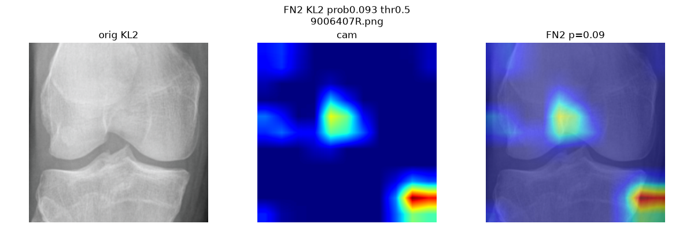
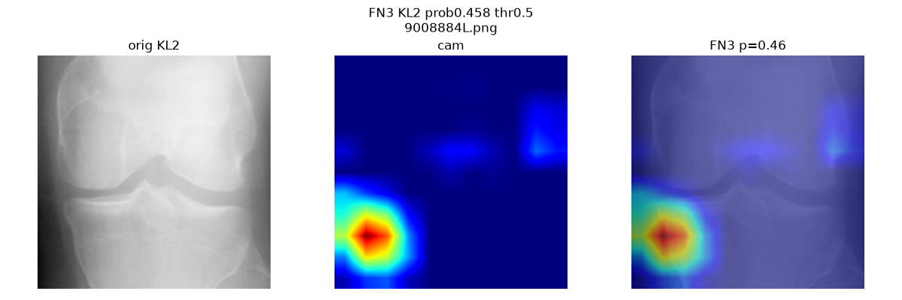
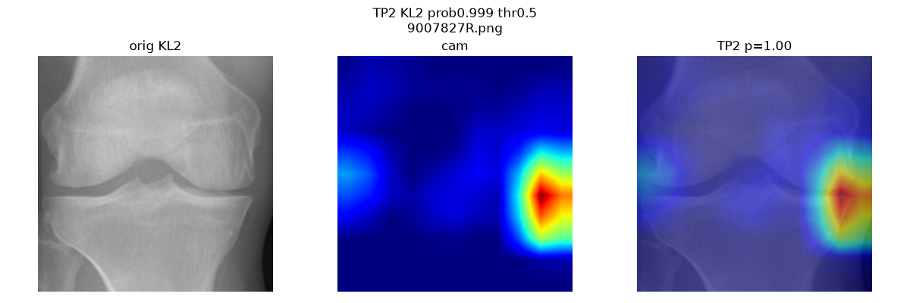
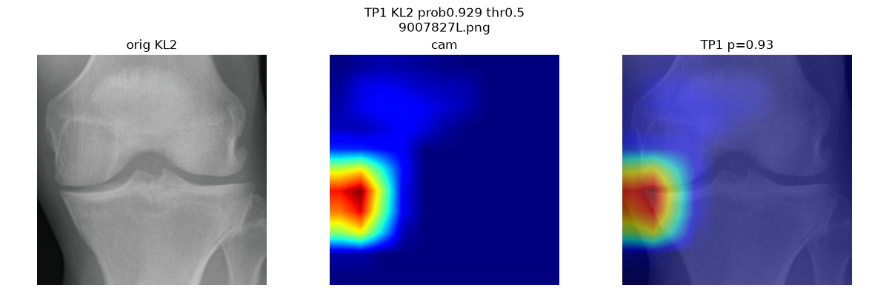

# subvision — knee OA pre-read (aid, never diagnosis)

Binary knee-OA classifier: KL 0,1 (neg) vs KL 2,3,4 (pos). DenseNet121, 380px.
Pre-read only. Needs radiologist sign-off. Demo / synthetic-data project, not for commercial or clinical use.

**Live demo:** https://subvision-vishsec.streamlit.app/ — upload PNG/JPG/DICOM, same code path as the tested FastAPI service.

## Task
- Input: single-view knee X-ray (PNG/JPG), 380x380, ImageNet normalize.
- Output: P(OA) + label @ thr 0.5 + Grad-CAM overlay + uncertainty flag (planned).
- Label rule: folder KL -> bin (`kl_to_bin`: 0,1->0 else 1). No JSN/osteophyte labels fed — model found pattern from image-level yes/no alone.

## Splits (`data/`, OAI-style KL 0-4 folders)
| split | KL0 | KL1 | KL2 | KL3 | KL4 | total | neg | pos |
|---|---|---|---|---|---|---|---|---|
| train | 2286 | 1046 | 1516 | 757 | 173 | 5778 | 3332 | 2446 |
| val | 328 | 153 | 212 | 106 | 27 | 826 | 481 | 345 |
| test | 639 | 296 | 447 | 223 | 51 | 1656 | 935 | 721 |
| auto_test | 604 | 275 | 403 | 200 | 44 | 1526 | 879 | 647 |
- `count.py` reproduces counts. Train on Kaggle GPU, eval local CPU or Kaggle.

## Results (recorded, do not re-run blindly)
- Val best (Kaggle `subvision_v1`): acc 0.881 (ep20/ep23), AUC 0.940 (ep24).
- Test (2026-10-08, `test_eval.py`): n=1656, AUC 0.945, acc 0.862 — TN 844 FP 91 FN 137 TP 584 = sens 0.810 / spec 0.903 / prec 0.865.
- **Test + hflip TTA (shipped v0.2.0, 2026-11-07): AUC 0.950, acc 0.868** — TN 852 FP 83 FN 135 TP 586 = sens 0.813 / spec 0.911. Gate: 0.949/0.875. Paired bootstrap: AUC gain significant on both splits (test CI [+0.002, +0.008], gate [+0.002, +0.008]); acc gains directional only. Full honesty: `MODEL_CARD.md` → *TTA*.
- Threshold (Kaggle `thereshold_calc`, 2026-10-09, single-pass):
  - 0.3: acc 0.859 sens 0.867 spec 0.853 (FN 96, FP 137) — don't-miss
  - 0.5: acc 0.862 sens 0.810 spec 0.903 (FN 137, FP 91) — default, conservative
  - 0.7: acc 0.862 sens 0.752 spec 0.947 (FN 179, FP 50) — quiet
- Grad-CAM (`gradcam.py`, `features.denseblock4`, 5TP+5FN all KL2): TP red on joint margin (e.g. TP2 9007827R p=1.00), FN red off-joint notch/corner (e.g. FN2 9006407R p=0.09). Visuals in `gradcam/`.
- Portfolio line: "Knee-OA KL-binary, DenseNet121 + hflip TTA — test AUC 0.950 / acc 86.8% (sens 0.81/spec 0.91, n=1,656, bootstrap CI excludes zero) — near published FDA-cleared benchmarks, with Grad-CAM + radiologist-sign-off workflow. Aid, never diagnosis."

## Serving (M1 ship 2026-10-28; TTA ship v0.2.0 2026-11-07)
- **ONNX**: `export_onnx.py` → `models/best_densenet121_knee.onnx` (28.2 MB), parity vs torch = 0.000000 — single-pass **and** TTA-average parity. Serve path is torch-free (onnxruntime CPU only).
- **TTA (v0.2.0):** serving averages base + width-mirrored pass (`serve.py`; response carries `tta: hflip` + `model_version: v0.2.0`). `SUBVISION_TTA=off` env reverts to single-pass for A/B.
- **API** (`serve.py`, `uvicorn serve:app`): `GET /health`, `POST /predict` — PNG/JPG/DICOM auto-detect (DICM magic bytes), MONOCHROME1 inversion + rescale for DICOM, latency breakdown in every response, request log `serve_log.jsonl`.
- **Tests** (`test_serve.py`, `pytest` → 4 passed, under TTA): health, PNG predict (prob in [0,1] + disclaimer), PNG↔DICOM parity |ΔP| < 1e-3 on the same image, determinism (p1 == p2).
- **Bench** (`bench.py`, n=50, same-day local A/B, CPU in-process): TTA off p50 **69.8 ms** total / on p50 **200.6 ms** (sustained-load variance seen; per-call profile ≈2× compute). Streamlit Cloud live with TTA: **201.2 ms** total (74 decode + 127.2 inference), request `8611663f7d6b4ec7`, 2026-11-07 (single-pass cloud was 87 ms; figure is one live request, n=50 cloud bench not run).
- **Docker**: `Dockerfile` (python:3.11-slim, onnxruntime only) — build + run + `/health` verified.
- **Streamlit** (`app.py`, live on Streamlit Cloud): imports `serve` — UI and API are literally the same inference function. Model card + disclaimer + latency breakdown on screen.

### What to try on the live demo (probs = v0.2.0 TTA)
- `data/test/3/9011053L.png` (KL3) → KL>=2, P ≈ 1.0000
- `data/test/0/9003175L.png` (KL0) → KL<2, P ≈ 0.0015
- `data/test/2/9006407R.png` (KL2, known false negative) → KL<2, P = 0.1643 (0.0925 single-pass — TTA softened the confident miss but did not fix it). The honest one.

## Visuals (Grad-CAM: orig | heat | overlay, FNs first)

Miss, red off joint (notch + corner), p=0.09:



Closest miss, p=0.46:



Hit, red on lateral joint margin, p=1.00:



Hit, p=0.93:



All 10 saves live in `gradcam/` (fn1-5 + tp1-5, every pick KL2).

## Data provenance & license
- **Source:** Kaggle `shashwatwork/knee-osteoarthritis-dataset-with-severity` — an **OAI-derived mirror** (filenames `9xxxxxxL/R.png`; see `REF/KAGGLE_FILE` line 9). Original cohort: Osteoarthritis Initiative (NIH/NHLBI) public imaging releases.
- **What we may publish:** trained weights, metrics, code, Grad-CAM overlays, qualitative examples — standard research/portfolio use.
- **What we may not claim:** external validity, clinical use, demographic fairness, or exact KL grading. Single cohort only; **no second external AUC** (M4 cancelled 2026-11-05 — no data-use forms filed).
- **Dataset terms:** respect the upstream Kaggle/OAI terms for the images themselves; do not re-host raw X-rays. This repo ships code + ONNX + small Grad-CAM PNGs, **not** the raw dataset (`data/` is gitignored).
- Formal write-up: `MODEL_CARD.md` (intended use, slices, limits).

## Operating cost / hardware
| Where | What | Cost |
|---|---|---|
| Local CPU (bench n=50, TTA on) | ONNX 28.2 MB, p50 **201 ms** total (single-pass A/B: 70 ms) | $0 — your laptop |
| Streamlit Cloud | same code path; **TTA: 201.2 ms total** (74 decode + 127.2 inference, live request 2026-11-07; single-pass was 87 ms) | free tier |
| Docker image | `python:3.11-slim` + onnxruntime only (no torch) | free |
| Training (reference only) | DenseNet121 25 ep, Kaggle T4 free GPU | $0 |
| Per inference @ cloud free tier | ~0.09 s CPU-second | negligible / free tier |

Assumptions: CPU-only serving, batch=1, 380×380, no GPU. No paid API, no vector DB, no external calls at inference. `latency_ms` breakdown is in every API response for real measurements, not estimates.

## Slice honesty (summary)
No age/sex/view metadata in data → **no demographic slices**. Per-KL is the only slice (KL2 hardest: ~66–72% binacc; 87% of errors on KL1/KL2). Full statement: `MODEL_CARD.md` → *Slice honesty*. Failures taxonomy: `FAILURES.md`.

## Limits
- Single-view only, OAI-derived data, needs local/Indian validation before any real use.
- Image-level labels only (no boxes/masks); mis-localization on borderline KL1/KL2 expected.
- Binary only (no exact KL 0-4, no JSN/osteophyte scores yet).
- Uncertainty band p∈[0.2,0.8] flags `borderline` → queue for sign-off (API + report). Calibration: `calib_eval.py` (ECE + reliability).

## Disclaimer
Demo project for learning + portfolio. Synthetic/demo data path. Not a medical device. Not for diagnosis, triage, or commercial use. Any future product needs licensed radiologist sign-off, DPDP consent, and regulatory clearance.

## Files in repo
- `MODEL_CARD.md` — formal model card (intended use, evals, slice honesty, limits)
- `FAILURES.md` — failure taxonomy for interviews (when it breaks and why)
- `train.py` — reproduce v0 recipe; appends `runs.json` (config + metrics + git hash)
- `calib_eval.py` — ECE + reliability on saved probs (`auto_v0_probs.npz` / `probs_test.npz`) → `calib_table.csv` + `calib_reliability.png`
- `drift_check.py` — new batch vs baseline (PSI + mean-p shift) → `drift_report.json`
- `test_eval.py` — eval @ 0.5 (slow on CPU, ~10+ min full test; use Kaggle for speed)
- `thresh_eval.py` — single pass, table 0.3/0.5/0.7 + saves `probs_test.npz`
- `auto_eval.py` — gate eval on `auto_test/` + saves `auto_v0_probs.npz`
- `perkl_eval.py` — paste as Kaggle cell for per KL table (fix ROOT/CKPT paths)
- `gradcam.py` — 5TP+5FN overlays to `gradcam/` (fast local, ~1-2 min)
- `report.py` — deterministic pre-read draft (Findings/Impression/Recommendation + sign-off line)
- `dicom_loader.py` — X-ray DICOM to 380px RGB for the same pipeline (needs pydicom)
- `count.py` — per-folder counts
- `export_onnx.py` — torch → ONNX with parity check (diff 0.000000, single + TTA)
- `tta_eval.py` — flip-variant TTA eval, any split (`--root`), saves per-variant probs
- `boot_tta.py` — paired bootstrap: is TTA's gain real? (10k resamples, CI + P)
- `serve.py` — FastAPI: /health, /predict, PNG/DICOM auto-detect, latency, **uncertainty band, model_version + request_id, TTA field**
- `app.py` — Streamlit UI, imports `serve` (same code path as API)
- `test_serve.py` — pytest: health, PNG, DICOM parity, determinism
- `bench.py` — n=50 latency percentiles on CPU
- `.github/workflows/ci.yml` — pytest on push (health/PNG/DICOM/determinism)
- `crop.py` / `eval5.py` / `gen_ablation_notebooks.py` — M2 ablation tooling (v0 stays production)
- `crop_gate.py` / `detect_boxes.py` / `prepare_annotate.py` — C5 knee-detector tooling (KEVA YOLO → QC sheet → detect-vs-fixed crop gate)
- `Dockerfile` + `requirements.txt` — torch-free serving image
- `gradcam/` — overlays (fn/tp + crop QC sheets)
- `models/best_densenet121_knee.onnx` — 28.2 MB, in repo (the served model)
- `models/best_densenet121_knee.pt` — local only, excluded from repo (lives on Kaggle dataset)
- Extended logs (numbers, build notes, checklists) stay local only, not in repo.

## Run
```powershell
.\.venv\Scripts\Activate.ps1
python .\test_eval.py             # full test @ 0.5
python .\auto_eval.py             # gate eval + auto_v0_probs.npz
python .\calib_eval.py            # ECE + reliability (job-pack #2)
python .\drift_check.py           # batch drift vs baseline (job-pack #13)
python .\gradcam.py               # visuals, fast
python .\report.py --demo         # sample drafts, instant
python -m pytest test_serve.py -q # serving tests (4)
uvicorn serve:app --port 8000     # API
streamlit run app.py              # same UI as the live demo
# train (GPU/Kaggle; writes runs.json): python train.py --data-root data
```
