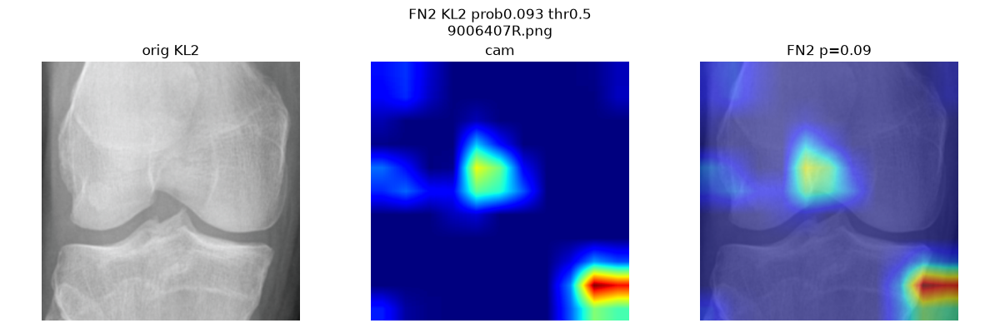
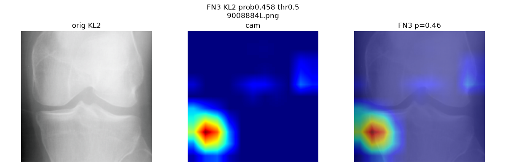
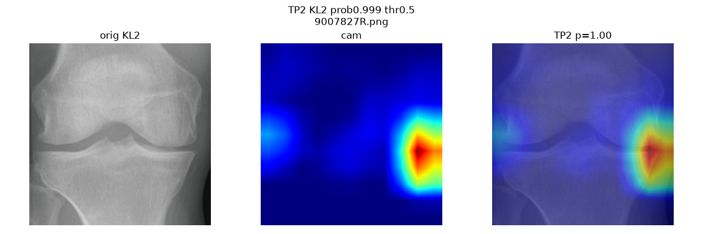
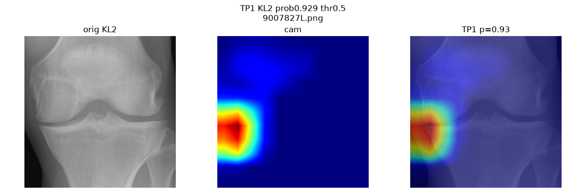

# subvision — knee OA pre-read (aid, never diagnosis)

Binary knee-OA classifier: KL 0,1 (neg) vs KL 2,3,4 (pos). DenseNet121, 380px.
Pre-read only. Needs radiologist sign-off. Demo / synthetic-data project, not for commercial or clinical use.

## Task
- Input: single-view knee X-ray (PNG/JPG), 380x380, ImageNet normalize.
- Output: P(OA) + label @ thr 0.5 + Grad-CAM overlay + uncertainty flag (planned).
- Label rule: folder KL -> bin (`kl_to_bin`: 0,1->0 else 1). No JSN/osteophyte labels fed — model found pattern from image-level yes/no alone.

## Splits (`data/`, OAI-style KL 0-4 folders)
| split | KL0 | KL1 | KL2 | KL3 | KL4 | total | neg | pos |
|---|---|---|---|---|---|---|---|---|
| train | 2286 | 1046 | 1516 | 757 | 173 | 5778 | 3332 | 2446 |
| val | 328 | 153 | 212 | 106 | 27 | 826 | 481 | 345 |
| test | 639 | 296 | 447 | 223 | 51 | 1656 | 935 | 721 |
| auto_test | 604 | 275 | 403 | 200 | 44 | 1526 | 879 | 647 |
- `count.py` reproduces counts. Train on Kaggle GPU, eval local CPU or Kaggle.

## Results (recorded, do not re-run blindly)
- Val best (Kaggle `subvision_v1`): acc 0.881 (ep20/ep23), AUC 0.940 (ep24).
- Test (2026-10-08, `test_eval.py`): n=1656, AUC 0.945, acc 0.862 — TN 844 FP 91 FN 137 TP 584 = sens 0.810 / spec 0.903 / prec 0.865.
- Threshold (Kaggle `thereshold_calc`, 2026-10-09):
  - 0.3: acc 0.859 sens 0.867 spec 0.853 (FN 96, FP 137) — don't-miss
  - 0.5: acc 0.862 sens 0.810 spec 0.903 (FN 137, FP 91) — default, conservative
  - 0.7: acc 0.862 sens 0.752 spec 0.947 (FN 179, FP 50) — quiet
- Grad-CAM (`gradcam.py`, `features.denseblock4`, 5TP+5FN all KL2): TP red on joint margin (e.g. TP2 9007827R p=1.00), FN red off-joint notch/corner (e.g. FN2 9006407R p=0.09). Visuals in `gradcam/`.
- Portfolio line: "Knee-OA KL-binary, DenseNet121 — test AUC 0.945 / acc 86.2% (sens 0.81/spec 0.90, n=1,656) — near published FDA-cleared benchmarks, with Grad-CAM + radiologist-sign-off workflow. Aid, never diagnosis."

## Visuals (Grad-CAM: orig | heat | overlay, FNs first)

Miss, red off joint (notch + corner), p=0.09:



Closest miss, p=0.46:



Hit, red on lateral joint margin, p=1.00:



Hit, p=0.93:



All 10 saves live in `gradcam/` (fn1-5 + tp1-5, every pick KL2).

## Limits
- Single-view only, OAI-like data, needs local/Indian validation before any real use.
- Image-level labels only (no boxes/masks); mis-localization on borderline KL1/KL2 expected.
- Binary only (no exact KL 0-4, no JSN/osteophyte scores yet).
- No calibration/cutoff locked for clinic; threshold is a choice, not a fix.

## Disclaimer
Demo project for learning + portfolio. Synthetic/demo data path. Not a medical device. Not for diagnosis, triage, or commercial use. Any future product needs licensed radiologist sign-off, DPDP consent, and regulatory clearance.

## Files in repo
- `test_eval.py` — eval @ 0.5 (slow on CPU, ~10+ min full test; use Kaggle for speed)
- `thresh_eval.py` — single pass, table 0.3/0.5/0.7 + saves `probs_test.npz`
- `perkl_eval.py` — paste as Kaggle cell for per KL table (fix ROOT/CKPT paths)
- `gradcam.py` — 5TP+5FN overlays to `gradcam/` (fast local, ~1-2 min)
- `report.py` — deterministic pre-read draft (Findings/Impression/Recommendation + sign-off line)
- `dicom_loader.py` — X-ray DICOM to 380px RGB for the same pipeline (needs pydicom)
- `count.py` — per-folder counts
- `gradcam/` — 10 overlays (fn1-5 + tp1-5)
- `models/best_densenet121_knee.pt` — local only, excluded from repo (lives on Kaggle dataset)
- Extended logs (numbers, build notes, checklists) stay local only, not in repo.

## Run
```powershell
.\.venv\Scripts\Activate.ps1
python .\test_eval.py        # full test @ 0.5
python .\gradcam.py          # 10 visuals, fast
python .\report.py --demo    # sample drafts, instant
```
